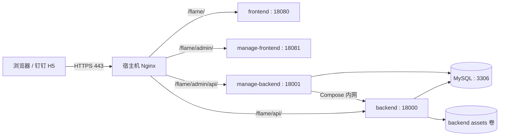

# Flame Sport Pheno 部署仓库

本仓库负责“燃动现象”项目的生产编排，不直接保存业务源码或运行数据。Docker Compose 统一构建并运行 MySQL、客户端前后端和管理端前后端；宿主机 Nginx 负责 HTTPS 终止、路径路由和静态资源缓存。

生产入口：

- 客户端：`https://pheno.szkl.com/flame/`
- 管理端：`https://pheno.szkl.com/flame/admin/`
- 客户端 API：`https://pheno.szkl.com/flame/api/`
- 管理端 API：`https://pheno.szkl.com/flame/admin/api/`

当前证书和 Nginx `server_name` 只包含 `pheno.szkl.com`，不要使用 `www.pheno.szkl.com`。如需支持 `www`，必须同时增加 DNS 记录、证书域名和 Nginx 配置。

## 整体架构



客户端是面向钉钉企业内部 H5 的 Vue 3 应用，生产模式登录依赖钉钉免登环境；管理端可直接使用普通浏览器访问。两个后端均基于 FastAPI，并共享同一个 MySQL 数据库。

## 仓库结构

```text
flame-sport-pheno-deploy/
├── .env.example                    # 可提交的环境变量模板
├── .env                            # 真实生产配置，不提交
├── .gitignore                      # 部署仓库白名单
├── README.md                       # 本文档
├── docker-compose.yml              # 五个服务和两个命名卷的编排
├── mysql/
│   ├── Dockerfile                  # MySQL 8.4、字符集和时区配置
│   └── init/
│       └── 001_flame_sport_pheno.sql  # 空数据卷首次启动时执行的表结构
├── flame-sport-pheno-be/           # 客户端后端，独立 Git 仓库
├── flame-sport-pheno-fe/           # 客户端前端，独立 Git 仓库
├── flame-sport-pheno-manage-be/    # 管理端后端，独立 Git 仓库
├── flame-sport-pheno-manage-fe/    # 管理端前端，独立 Git 仓库
├── backups/                        # 本地数据库和资源备份，不提交
└── dev/                            # 本地开发工作区，不参与生产构建、不提交
```

顶层仓库采用 Git 白名单：默认忽略所有内容，只放行 `.gitignore`、`.env.example`、`README.md`、`docker-compose.yml` 和 `mysql/` 下的部署初始化文件。四个业务目录各自拥有 `.git`，更新和提交必须在对应子仓库内完成。

Compose 的构建上下文固定使用顶层四个业务目录，`dev/` 下的代码不会进入生产镜像。

## 服务与持久化

| Compose 服务 | 用途 | 容器端口 | 默认宿主机端口 | 暴露范围 |
| --- | --- | ---: | ---: | --- |
| `mysql` | MySQL 8.4 数据库 | 3306 | 13306 | 所有网卡 |
| `backend` | 客户端 FastAPI | 8000 | 18000 | 仅 `127.0.0.1` |
| `frontend` | 客户端静态页面 | 80 | 18080 | 所有网卡 |
| `manage-backend` | 管理端 FastAPI | 8000 | 18001 | 仅 `127.0.0.1` |
| `manage-frontend` | 管理端静态页面 | 80 | 18081 | 仅 `127.0.0.1` |

生产访问应统一经过宿主机 Nginx。MySQL 和客户端前端当前会监听所有网卡，必须通过云安全组或宿主机防火墙限制 `13306`、`18080` 等内部端口的外部访问；MySQL 如不再需要远程维护，建议后续改为仅绑定回环地址。

Compose 会自动创建以下命名卷：

| Compose 卷 | 实际默认名称 | 容器挂载点 | 内容 |
| --- | --- | --- | --- |
| `flame_mysql_data` | `flame-sport-pheno_flame_mysql_data` | `/var/lib/mysql` | MySQL 全部数据 |
| `flame_backend_assets` | `flame-sport-pheno_flame_backend_assets` | `/workspace/assets` | 用户头像、项目图片、凭证图片等运行期资源 |

`docker compose down` 只删除容器和 Compose 网络，会保留这两个卷；`docker compose down -v` 会删除卷及其中的数据，生产环境不要执行，除非已经确认备份有效且确实要重置全部数据。

## 部署准备

建议使用 Linux 服务器，并准备：

- Git
- Docker Engine
- Docker Compose v2（使用 `docker compose` 命令）
- 宿主机 Nginx
- Certbot 或其他可用的 TLS 证书
- 已解析到服务器公网 IP 的域名

先克隆部署仓库及四个业务仓库。当前生产工作区的业务仓库统一使用 `feature` 分支；正式切换分支时应四个仓库一起确认。

```bash
git clone https://github.com/caicai-6666/flame-sport-pheno-deploy.git
cd flame-sport-pheno-deploy

git clone --branch feature https://github.com/caicai-6666/flame-sport-pheno-be.git
git clone --branch feature https://github.com/caicai-6666/flame-sport-pheno-fe.git
git clone --branch feature https://github.com/caicai-6666/flame-sport-pheno-manage-be.git
git clone --branch feature https://github.com/caicai-6666/flame-sport-pheno-manage-fe.git
```

如果仓库需要身份验证，请使用已配置的 SSH 地址或凭据，不要把访问令牌写进部署文件。

## 配置环境变量

从模板生成本地配置：

```bash
cp .env.example .env
chmod 600 .env
```

至少检查并替换以下配置：

| 配置组 | 关键变量 | 说明 |
| --- | --- | --- |
| MySQL | `MYSQL_ROOT_PASSWORD`、`MYSQL_PASSWORD` | 必填强密码；应用密码会同时进入客户端数据库 URL，建议使用足够长的字母、数字及 `._-` 组合 |
| 管理登录 | `MANAGE_ADMIN_KEY` | 必填，管理端登录密钥 |
| 钉钉 | `DINGTALK_CLIENT_ID`、`DINGTALK_CLIENT_SECRET`、`DINGTALK_AGENT_ID`、`VUE_APP_DINGTALK_CORP_ID`、`VUE_APP_DINGTALK_CLIENT_ID` | 客户端生产免登和通知所需 |
| DeepSeek | `DEEPSEEK_API_KEY`、`LLM_PRELIMINARY_REVIEW_ENABLED` | 不使用大模型初审时，密钥留空且开关保持 `false` |
| 入口路径 | `VUE_APP_API_BASE_URL`、`MANAGE_APP_BASE_PATH`、`MANAGE_API_BASE_PATH` | 默认值已与 `/flame` 的 Nginx 路由对应 |
| 端口 | `MYSQL_PORT`、`BACKEND_PORT`、`FRONTEND_PORT`、`MANAGE_BACKEND_PORT`、`MANAGE_FRONTEND_PORT` | 修改后必须同步修改宿主机 Nginx |

`.env.example` 已完整列出 Compose 使用的变量和默认值。`.env` 含真实密钥，已被顶层白名单排除，禁止提交。

客户端和管理端的 `VUE_APP_*`、`VITE_*` 配置在镜像构建时写入静态文件。修改这些变量后，仅重启容器不会生效，必须重新构建对应前端镜像：

```bash
docker compose up -d --build frontend manage-frontend
```

修改后先检查最终配置能否正常展开：

```bash
docker compose config >/dev/null
```

注意：`docker compose config` 的完整输出会包含展开后的密码，不要将输出粘贴到日志或工单中。

---

## 客户端定时初审配置

客户端后端通过标准异步 Responses API 调用 DeepSeek，初审模型默认使用已验证的 `deepseek-flash`。以下变量由部署目录 `.env` 读取并注入 `backend` 容器：

| 变量 | 默认值 | 行为 |
| --- | --- | --- |
| `LLM_PRELIMINARY_REVIEW_ENABLED` | `false` | 是否启动定时初审 |
| `LLM_PRELIMINARY_REVIEW_INTERVAL_SECONDS` | `900` | 每轮结束后的等待秒数 |
| `LLM_PRELIMINARY_REVIEW_MIN_AGE_SECONDS` | `300` | 上传后至少等待的秒数 |
| `LLM_PRELIMINARY_REVIEW_MIN_BATCH_SIZE` | `10` | 当前待审数量门槛，必须为正整数 |
| `LLM_PRELIMINARY_REVIEW_CONCURRENCY` | `3` | 单个定时批次并发的用户项目组数，必须为正整数 |

连续第三次非空扫描仍未达到数量门槛时，会审核本轮符合条件的记录。空扫描、赛季切换或进程重启会重置等待计数。不同用户项目并发，同组串行且月初优先；该并发限制不覆盖管理端立即初审，也不是多实例全局限制。

已有部署的 `.env` 请补入最小数量和并发数，并核对 `DEEPSEEK_MODEL=deepseek-flash`；仅修改模板不会覆盖已有 `.env`。配置变更后在部署目录执行以下命令重新创建后端容器，单纯 `docker compose restart` 不会更新容器环境变量：

```bash
docker compose config --quiet
docker compose up -d --no-deps backend
```

如同时更新了后端代码，使用 `docker compose up -d --build --no-deps backend`。管理员查询智能体使用独立的 `AGENT_QUERY_DEEPSEEK_*` 配置，不受本节初审配置影响。

---

## 初始化数据库和资源卷

### 全新数据库

首次部署先构建并启动 MySQL：

```bash
docker compose up -d --build mysql
docker compose ps mysql
docker compose logs --tail=100 mysql
```

当 `flame_mysql_data` 是空卷时，MySQL 官方入口会按文件名顺序自动执行镜像中的 `/docker-entrypoint-initdb.d/*.sql`。本项目的 `mysql/init/001_flame_sport_pheno.sql` 只创建表结构，不包含生产业务数据。

初始化脚本只在空数据目录上执行一次。以后即使修改 SQL 或重建 MySQL 镜像，只要原卷仍存在，就不会自动再次执行。

### 导入初始业务数据

`backups/` 不受 Git 跟踪，新服务器需要通过安全渠道单独放入数据文件。对于“只有业务数据、不含建表语句”的普通 SQL，在 MySQL 健康后导入：

```bash
DATA_DUMP="$PWD/backups/flame_sport_pheno_data.sql"
docker compose exec -T mysql \
  sh -c 'exec mysql -uroot -p"$MYSQL_ROOT_PASSWORD" "$MYSQL_DATABASE"' \
  < "$DATA_DUMP"
```

压缩的 SQL 使用：

```bash
DATA_DUMP="$PWD/backups/flame_sport_pheno.sql.gz"
gzip -dc "$DATA_DUMP" | docker compose exec -T mysql \
  sh -c 'exec mysql -uroot -p"$MYSQL_ROOT_PASSWORD" "$MYSQL_DATABASE"'
```

全量备份通常包含 `DROP TABLE` 和表结构，会覆盖现有结构。不要把“结构初始化 SQL + 数据迁移 SQL + 多份全量备份”依次全部导入；应先确认备份类型并只选择一条恢复链路。导入前建议先创建当前数据库备份。

### 导入客户端资源

先构建客户端后端镜像，它声明的 `flame_backend_assets` 卷会由 Compose 自动创建：

```bash
docker compose build backend
```

资源压缩包内部应直接以 `images/` 等资源目录开头，而不是再嵌套一层 `assets/`。可先检查：

```bash
tar -tzf backups/flame_backend_assets.tar.gz | head
```

恢复到命名卷：

```bash
ASSET_ARCHIVE="$PWD/backups/flame_backend_assets.tar.gz"
docker compose run --rm --no-deps \
  --volume "$ASSET_ARCHIVE:/backup/assets.tar.gz:ro" \
  backend \
  sh -c 'tar -xzf /backup/assets.tar.gz -C /workspace/assets'
```

该命令会把同名文件覆盖到现有卷中，但不会主动清空其他文件。对已经投入使用的资源卷执行恢复前，应先备份当前内容。

## 启动全部服务

数据库和初始资源准备完成后，构建并启动整套服务：

```bash
docker compose up -d --build
docker compose ps
```

依赖启动顺序由健康检查控制：MySQL 健康后启动客户端后端，随后启动客户端前端和管理端后端，最后启动管理端前端。

在宿主机上检查各入口：

```bash
curl -fsS http://127.0.0.1:18000/flame/api/
curl -fsS http://127.0.0.1:18001/flame/admin/api/health
curl -fsSI http://127.0.0.1:18080/flame/
curl -fsSI http://127.0.0.1:18081/flame/admin/
```

如果端口在 `.env` 中改过，请相应替换命令中的端口。

## 配置宿主机 Nginx

生产路由应放在宿主机 Nginx 的 `pheno.szkl.com` HTTPS `server` 块中。以下是与默认 Compose 端口对应的核心配置：

```nginx
server {
    listen 443 ssl;
    server_name pheno.szkl.com;

    ssl_certificate /etc/letsencrypt/live/pheno.szkl.com/fullchain.pem;
    ssl_certificate_key /etc/letsencrypt/live/pheno.szkl.com/privkey.pem;

    client_max_body_size 60m;

    # 客户端后端的 /admin 接口只允许 Compose 内部的管理后端调用。
    location = /flame/api/admin { return 404; }
    location ^~ /flame/api/admin/ { return 404; }

    location = /flame/admin/api {
        proxy_pass http://127.0.0.1:18001;
        include /etc/nginx/proxy_params;
    }

    location ^~ /flame/admin/api/ {
        proxy_pass http://127.0.0.1:18001;
        include /etc/nginx/proxy_params;
    }

    location = /flame/admin {
        return 301 /flame/admin/$is_args$args;
    }

    # Vite 产物带内容哈希，可长期缓存。
    location ^~ /flame/admin/assets/ {
        proxy_pass http://127.0.0.1:18081;
        include /etc/nginx/proxy_params;
        proxy_hide_header Cache-Control;
        proxy_hide_header Expires;
        add_header Cache-Control "public, max-age=31536000, immutable" always;
    }

    location ^~ /flame/admin/ {
        proxy_pass http://127.0.0.1:18081;
        include /etc/nginx/proxy_params;
    }

    location = /flame/api {
        proxy_pass http://127.0.0.1:18000;
        include /etc/nginx/proxy_params;
    }

    location ^~ /flame/api/ {
        proxy_pass http://127.0.0.1:18000;
        include /etc/nginx/proxy_params;
    }

    location = /flame {
        return 301 /flame/$is_args$args;
    }

    # Vue CLI 产物带 8 位内容哈希，可长期缓存。
    location ~* "^/flame/(img|js|css|fonts)/(.+\.[0-9a-f]{8}\.(?:css|js|png|jpe?g|webp|gif|svg|woff2?))$" {
        proxy_pass http://127.0.0.1:18080;
        include /etc/nginx/proxy_params;
        proxy_hide_header Cache-Control;
        proxy_hide_header Expires;
        add_header Cache-Control "public, max-age=31536000, immutable" always;
    }

    location /flame/ {
        proxy_pass http://127.0.0.1:18080;
        include /etc/nginx/proxy_params;
    }
}

server {
    listen 80;
    server_name pheno.szkl.com;
    return 301 https://$host$request_uri;
}
```

前端容器会对 HTML 禁用长期缓存，并为构建产物设置缓存头；宿主机 Nginx 再为带哈希的 JS、CSS、图片和字体明确设置一年不可变缓存。头像、活动图片和运动凭证等由客户端 API 返回的资源，其浏览器缓存时间由 `IMAGE_CACHE_MAX_AGE_SECONDS` 和 `MANAGE_IMAGE_CACHE_SECONDS` 控制。

若证书尚未签发，先启用只含 HTTP `server_name` 的站点，再使用 Certbot 申请 `pheno.szkl.com` 证书。不要在证书文件尚不存在时直接加载上述 HTTPS 配置。

典型的站点启用与检查命令：

```bash
sudo ln -s /etc/nginx/sites-available/pheno /etc/nginx/sites-enabled/pheno
sudo nginx -t
sudo systemctl reload nginx
```

如果链接已经存在，不需要重复创建。每次修改端口、域名或路由后都要先执行 `sudo nginx -t`，测试通过后再 reload。

## 日常运维

查看状态和日志：

```bash
docker compose ps
docker compose logs --tail=200
docker compose logs -f backend manage-backend
```

更新全部业务代码并重建：

```bash
git -C flame-sport-pheno-be pull --ff-only
git -C flame-sport-pheno-fe pull --ff-only
git -C flame-sport-pheno-manage-be pull --ff-only
git -C flame-sport-pheno-manage-fe pull --ff-only
docker compose up -d --build
```

只更新单个服务时，可以指定服务名；Compose 会按需处理依赖：

```bash
docker compose up -d --build backend
```

停止服务但保留数据：

```bash
docker compose down
```

### 备份数据库

```bash
mkdir -p backups
docker compose exec -T mysql \
  sh -c 'exec mysqldump -uroot -p"$MYSQL_ROOT_PASSWORD" --single-transaction --routines --triggers "$MYSQL_DATABASE"' \
  | gzip > "backups/flame_sport_pheno_$(date +%Y%m%d_%H%M%S).sql.gz"
```

### 备份客户端资源

```bash
mkdir -p backups
docker compose exec -T backend \
  tar -czf - -C /workspace/assets . \
  > "backups/flame_backend_assets_$(date +%Y%m%d_%H%M%S).tar.gz"
```

备份完成后应复制到服务器之外的受控存储，并定期验证能否恢复。数据库和用户图片可能包含敏感数据，不能提交到 Git。

## 常见问题

- **MySQL 重建后没有再次执行初始化 SQL**：这是命名卷仍有数据时的正常行为。初始化目录只对空数据卷生效，需要变更结构时应执行明确的迁移 SQL。
- **管理端刷新后 404**：确认访问路径带尾部斜杠，并确保 `/flame/admin/` 转发到 `18081`，且 `/flame/admin/api/` 规则位于管理前端规则之前。
- **图片 404**：同时检查数据库保存的资源路径和 `flame_backend_assets` 卷中的实际文件，不能只恢复其中一项。
- **修改前端环境变量后页面仍是旧配置**：重新构建对应前端镜像，并检查 HTML 没有被代理或浏览器长期缓存。
- **客户端普通浏览器无法完成登录**：生产客户端依赖钉钉免登，应从已发布的钉钉 H5 微应用进入；管理端不受此限制。
- **域名完全无法连接且浏览器 Network 面板没有请求**：先确认使用的是 `pheno.szkl.com` 而不是未配置的 `www.pheno.szkl.com`，再检查 DNS、本机代理/VPN和网络过滤规则。

## 提交边界

在部署仓库根目录执行 `git status` 时，只应看到部署编排、环境变量模板、README 和 MySQL 初始化文件的变更。业务源码即使被修改，也不会出现在顶层仓库状态中，需要进入对应子仓库单独检查和提交。

提交前至少执行：

```bash
docker compose config >/dev/null
git check-ignore -v .env backups flame-sport-pheno-be
git status --short
```
